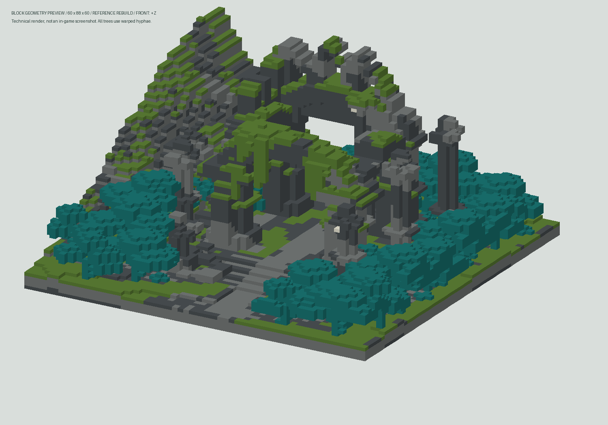

# Заросшие каменные руины для Minecraft Java 1.21.11

Готовые схематики для Litematica и WorldEdit: высокие разрушенные арки, отдельные обломанные колонны, ступенчатый склон слева, лес, дорожки и широкая лестница перед входом. Это интерпретация композиции референса с ограниченной палитрой.

**Компактная версия 2 построена заново по референсу.** У неё массивные нижние опоры и обрамление входа, сломанная верхняя стена с узкими окнами, неровные мшистые свесы, каменные борозды на склоне и более плотный лес. Сжатие исходной схематики больше не используется. Ранняя версия 129 × 88 × 129 сохранена отдельно; она не была переработана.

## Скачать

Нажмите на нужный файл ниже. Если браузер показывает страницу файла, нажмите **Download raw file** (значок скачивания). Можно также скачать весь репозиторий через **Code → Download ZIP**.

| Версия | Размер выделения (X × Y × Z) | Litematica | WorldEdit | Комплект ZIP |
| --- | --- | --- | --- | --- |
| Компактная v2 | **60 × 88 × 60** | [Скачать .litematic](https://github.com/melonwin9110-code/test100/raw/refs/heads/main/compact/overgrown_sanctuary_60x88x60.litematic) | [Скачать .schem](https://github.com/melonwin9110-code/test100/raw/refs/heads/main/compact/overgrown_sanctuary_60x88x60.schem) | [Скачать комплект](https://github.com/melonwin9110-code/test100/raw/refs/heads/main/compact/compact_60x88x60.zip) |
| Ранняя большая версия | 129 × 88 × 129 | [Скачать .litematic](https://github.com/melonwin9110-code/test100/raw/refs/heads/main/original/overgrown_sanctuary.litematic) | [Скачать .schem](https://github.com/melonwin9110-code/test100/raw/refs/heads/main/original/overgrown_sanctuary.schem) | [Скачать комплект](https://github.com/melonwin9110-code/test100/raw/refs/heads/main/original/overgrown_sanctuary_bundle.zip) |

Компактная версия содержит **49 730 непустых блоков**, исходная — **212 497**. Размеры включают основание ландшафта и воздушный запас сверху; высота 88 — размер выделения. Верхний занятый слой компактной версии — **Y=62**. Передняя сторона — **+Z**, склон — **−X**. Деревья сделаны целиком из искажённого дерева.

## Компактная версия: техническое превью



Это технический рендер блоков, без игровых текстур и шейдеров. [Другой ракурс компактной версии](compact/preview_isometric.png). [Превью ранней большой версии](original/preview.png).

## Установка

### Litematica

1. Установите версии **Litematica** и **MaLiLib**, совместимые с вашей версией Minecraft.
2. Скопируйте `.litematic` в папку `schematics` вашей игровой сборки (обычно `.minecraft/schematics/`).
3. Откройте меню Litematica → **Load Schematics**, загрузите файл и создайте размещение (**Create Placement**).
4. Выберите положение в **Schematic Placements**. Нижний угол выделения — начало основания ландшафта. Для вставки всей постройки в творческом режиме используйте **Paste schematic in world** с необходимыми правами. Обычная загрузка схемы создаёт проекцию.

### WorldEdit

1. Скопируйте `.schem` в каталог схем WorldEdit: обычно `config/worldedit/schematics/` или `plugins/WorldEdit/schematics/`.
2. Для компактной версии выполните `//schem load overgrown_sanctuary_60x88x60`.
3. Встаньте в точку минимального угла основания и выполните `//paste`.

Выберите свободный участок: схема содержит массив основания и воздух в проёмах. `//paste -a` пропускает воздух, поэтому существующие блоки могут остаться внутри входа.

## Палитра и проверки

В обоих файлах разрешены только:

- `minecraft:smooth_basalt`;
- `minecraft:stone`;
- `minecraft:calcite`;
- `minecraft:warped_hyphae`;
- `minecraft:moss_block`;
- `minecraft:air` для пустот.

Ступени состоят из полных блоков. Нет плит, листвы, лиан, освещения, сущностей или блоков с дополнительными данными.

Генераторы проверяют GZIP/NBT, размеры, декодирование всех упакованных состояний Litematica, совпадение всех блоков с WorldEdit и проходимость входа. Компактный проход имеет ширину **5 блоков**, просвет **4 блока**, подъёмы не выше **1 блока**. Исходный проход имеет ширину 7 блоков. Повторный запуск генераторов даёт побайтно те же `.litematic` и `.schem`.

Результаты: [компактная версия](compact/validation.json), [исходная версия](original/validation.json), [независимая повторная проверка](audit_report.json). Независимый валидатор читает готовые файлы, не импортирует генераторы и проверяет всю ширину проходов в обеих версиях. Запуск из любой папки: `python3 /путь/к/репозиторию/validate_independent.py`. Контрольные суммы: [SHA256SUMS.txt](SHA256SUMS.txt).

Дополнительно оба формата прочитаны через **Litemapy 0.11.0b0 / nbtlib 2.0.4**: совпали все 1 464 408 позиций исходной и 316 800 позиций компактной версии, включая воздух. [Отчёт библиотечной проверки](litemapy_crosscheck.json), [проверка воспроизводимости](reproducibility.json). `DataVersion=4671` соответствует Minecraft Java 1.21.11 по [данным mcmeta](https://github.com/misode/mcmeta/blob/summary/versions/data.json).

**В самой игре Minecraft, Litematica и WorldEdit загрузка не проверялась.** Программная проверка файлов не заменяет эту проверку.

## Автономные генераторы

Нужен только Python 3, без внешних библиотек. Скачайте нужный скрипт и запустите в отдельной папке:

```sh
python3 generate_compact.py
```

Для исходной версии используйте `generate_ruins.py`. В Windows можно выполнить `py generate_compact.py`. Скрипт создаёт оба формата и `validation.json` в текущей папке; одноимённые файлы перезаписываются.

- [Генератор компактной версии](compact/generate_compact.py)
- [Генератор исходной версии](original/generate_ruins.py)
