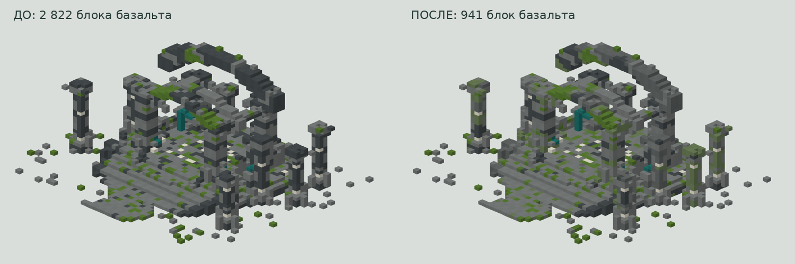

# Правка загруженного ancient_ruins_warped.schem: меньше базальта

Основой служит **файл пользователя**, а не ранее сгенерированные модели. Исходник сохранён без изменений: [ancient_ruins_warped.schem](ancient_ruins_warped.schem).

**Размер остался 55 × 34 × 51 (X × Y × Z). Высота — ровно 34 блока.** Занятые границы до и после: X=0…54, Y=0…33, Z=6…50. Все исходные непустые позиции сохранены; арки, колонны и ступени не перемещались и не масштабировались. Начало координат/смещение `[0, 0, 0]` сохранено.

## Скачать отредактированную постройку

- **[Litematica .litematic](https://github.com/melonwin9110-code/test100/raw/refs/heads/main/uploaded_edit/ancient_ruins_warped_edited.litematic)**
- **[WorldEdit .schem](https://github.com/melonwin9110-code/test100/raw/refs/heads/main/uploaded_edit/ancient_ruins_warped_edited.schem)**
- **[ZIP: оба файла, исходник, редактор и проверка](https://github.com/melonwin9110-code/test100/raw/refs/heads/main/uploaded_edit/ancient_ruins_warped_edited_bundle.zip)**



[Превью после правки крупнее](preview.png). Сравнение показывает состояние **до и после замены базальта**. Геометрия одинакова; это технические рендеры без игровых текстур и шейдеров.

## Что изменено

В последней правке количество гладкого базальта уменьшено примерно втрое: **2 822 → 941**. Заменённые 1 881 блок распределены почти поровну:

- **941 блок булыжника** (`minecraft:cobblestone`);
- **940 блоков замшелого булыжника** (`minecraft:mossy_cobblestone`).

Округление необходимо, поскольку 2 822 не делится на три нацело. Менялись только позиции прежнего базальта. Все остальные блоки, пустоты, оси дерева, высота и форма остались точно как в предыдущей отредактированной версии.

Сохранённые предыдущие правки исходника:

- 2 104 блока `cobblestone` заменены на `stone`.
- 60 блоков `warped_stem` заменены на `warped_hyphae`; направления осей X/Y сохранены.
- 86 существующих открытых каменных поверхностей покрыты мхом.
- Добавлены 12 небольших обломков с опорой снизу.
- Закрыты три дырки в полу перед входом. Проход шириной 5 блоков проверен по всей длине 36 блоков; просвет не менее 2 блоков, подъёмы не выше одного блока.

В итоге **7 185 непустых блоков** вместо 7 170. Текущая палитра: `smooth_basalt`, `stone`, `calcite`, `warped_hyphae`, `moss_block`, **`cobblestone`, `mossy_cobblestone`** и воздух. Девять состояний палитры соответствуют семи строительным типам и воздуху: у дерева есть два направления оси. Нет ступеней, плит, листвы, лиан или освещения.

Исходный файл сохранён как получен и содержит прежнюю палитру. Два вида булыжника добавлены по последнему запросу пользователя; они расширяют прежнюю палитру.

## Установка

**Litematica:** установите совместимые Litematica/MaLiLib, скопируйте `.litematic` в `.minecraft/schematics/`, откройте **Load Schematics** и создайте размещение (**Create Placement**).

**WorldEdit:** поместите `.schem` в каталог `schematics` WorldEdit, выполните `//schem load ancient_ruins_warped_edited`, затем `//paste`. Передняя сторона входа — **+Z**. Нижний слой на Y=0: выбирайте точку вставки так, чтобы у дорожек и разбросанных обломков был грунт снизу.

Форматы: Litematica v6 и Sponge v2, `DataVersion=4671` (Minecraft Java 1.21.11). **В самой игре проверка не проводилась.**

## Проверка и воспроизведение

[validation.json](validation.json) содержит точный список локальных изменений, границы, контрольные суммы и результаты проверки. `.litematic` и `.schem` полностью прочитаны после записи и содержат одинаковые блоки.

[Независимая проверка](independent_audit.json) также подтвердила, что изменены ровно 1 881 позиция прежнего базальта, а геометрия, весь верхний слой Y=33 и все прочие состояния блоков сохранены. Проверены проход и побайтная воспроизводимость. Через Litemapy 0.11.0b0 / nbtlib 2.0.4 сравнены все 95 370 позиций вместе со свойствами блоков.

Чтобы воспроизвести правку, положите рядом `edit_uploaded.py` и неизменённый `ancient_ruins_warped.schem`, затем запустите:

```sh
python3 edit_uploaded.py
```

В Windows: `py edit_uploaded.py`. Нужен только Python 3, без внешних библиотек. Скрипт перезаписывает файлы с суффиксом `_edited` и `validation.json`, исходник не меняет. Можно выбрать выходную папку: `python3 edit_uploaded.py --output /путь/к/папке`.
